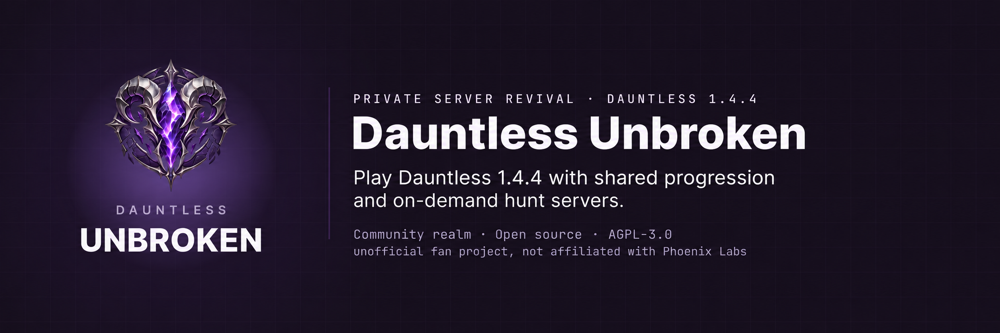

# Dauntless Unbroken

A fresh community realm for **Dauntless 1.4.4**, with a purple launcher, persistent progression and on-demand hunt servers.

[**Download the launcher**](https://github.com/Vvoidddd/dauntless-unbroken/releases/latest) · [**Documentation**](https://vvoidddd.github.io/dauntless-unbroken/) · [**Build status**](https://github.com/Vvoidddd/dauntless-unbroken/actions)

## Play

Install the Unbroken launcher, add your realm invite and sign in with your personal account key. The launcher verifies game files, resumes downloads and receives updates from this repository. Offline play uses a separate save.

**This is a fresh realm. Previous accounts and progression are not imported.**

## Features

- Saved accounts, progression, inventory, loadouts, friends and parties.
- Weekly Rams shop rotation, the once-per-account Void creator reward and Granny Strega crafting/purchases.
- Fair matchmaking queues, resource admission and idle hunt cleanup.
- Moderation, health monitoring, Discord key distribution and operator tooling.
- Windows launcher installer and portable ZIP; Linux packaging and server-port checks.

## Host or develop

Start with [how the server works](docs/server.md), the [Windows installation guide](docs/setup/windows-server.md), [configuration reference](docs/reference/configuration.md) and [contributing guide](CONTRIBUTING.md).

| Component | Directory |
|:--|:--|
| Accounts and game services | `DauntlessUnbrokenMetagame` |
| TLS gateway and access control | `DauntlessUnbrokenGateway` |
| Hunt allocation | `DauntlessUnbrokenDeployServer` |
| Content distribution | `DauntlessUnbrokenContent` |
| Native game integration | `DauntlessUnbrokenInternalServer` |
| Launcher | `DauntlessUnbrokenLauncher` |
| Discord key bot | `DauntlessUnbrokenDiscordBot` |

CI builds and tests the services, native integration, launcher, server kit, Linux/OpenBSD ports and documentation. Launcher releases use the version in `DauntlessUnbrokenLauncher/package.json` after required checks pass.

## Legal

Independent community project; not affiliated with Phoenix Labs or Epic Games. Retail game assets are not included in this repository. Source is licensed under [AGPL-3.0-only](LICENSE.txt). Required copyright, source provenance and bundled software notices are retained in [UPSTREAM.md](UPSTREAM.md) and [THIRD-PARTY-NOTICES.txt](DauntlessUnbrokenLauncher/THIRD-PARTY-NOTICES.txt).
