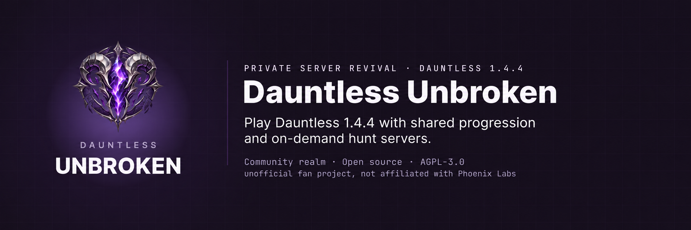

# Dauntless Unbroken

Dauntless Unbroken runs **Dauntless 1.10.5** with shared accounts, saved progression and on-demand game servers.

[**Download the launcher**](https://vvoidddd.github.io/dauntless-unbroken/download/) · [**Documentation**](https://vvoidddd.github.io/dauntless-unbroken/) · [**Build status**](https://github.com/Vvoidddd/dauntless-unbroken/actions)

## Play

Install the Unbroken launcher, add your realm invite and sign in with your account key. The launcher checks game files, resumes downloads from our Cloudflare mirror and receives updates from this repository.

Existing Unbroken 1.4.4 players can use their saved account key. The server imports eligible accounts into the 1.10.5 database without changing the original save. Gear, cosmetics, quests and island unlocks carry over; legacy mastery and the new weapon-level system are separate. Keep your key private. Offline 1.10.5 play is not available yet.

## Features

- Saved accounts, progression, inventory, loadouts, friends and parties.
- Weekly Rams shop rotation, the once-per-account Void creator reward and Granny Strega crafting/purchases.
- Fair matchmaking queues, resource admission and idle hunt cleanup.
- Moderation, health monitoring, Discord key distribution and operator tooling.
- Windows installer and portable ZIP, plus a native Linux AppImage. Steam Deck support is still being tested.

## Host or develop

Start with [how the server works](docs/server.md), the [Windows installation guide](docs/setup/windows-server.md), [configuration reference](docs/reference/configuration.md) and [contributing guide](CONTRIBUTING.md).

| Component | Directory |
|:--|:--|
| Accounts and game services | `DauntlessUnbrokenMetagame` |
| TLS gateway and access control | `DauntlessUnbrokenGateway` |
| Hunt allocation | `DauntlessUnbrokenDeployServer` |
| Content distribution | `DauntlessUnbrokenContent` |
| Native 1.10.5 integration | `experiments/1.10.5` |
| Launcher | `DauntlessUnbrokenLauncher` |
| Discord key bot | `DauntlessUnbrokenDiscordBot` |

CI builds and tests the services, native integration, launcher, server kit, Linux/OpenBSD ports and documentation. Launcher releases use the version in `DauntlessUnbrokenLauncher/package.json` after required checks pass.

## Legal

Independent community project; not affiliated with Phoenix Labs or Epic Games. Retail game assets are not included in this repository. Source is licensed under [AGPL-3.0-only](LICENSE.txt). Required copyright, source provenance and bundled software notices are retained in [UPSTREAM.md](UPSTREAM.md) and [THIRD-PARTY-NOTICES.txt](DauntlessUnbrokenLauncher/THIRD-PARTY-NOTICES.txt).
